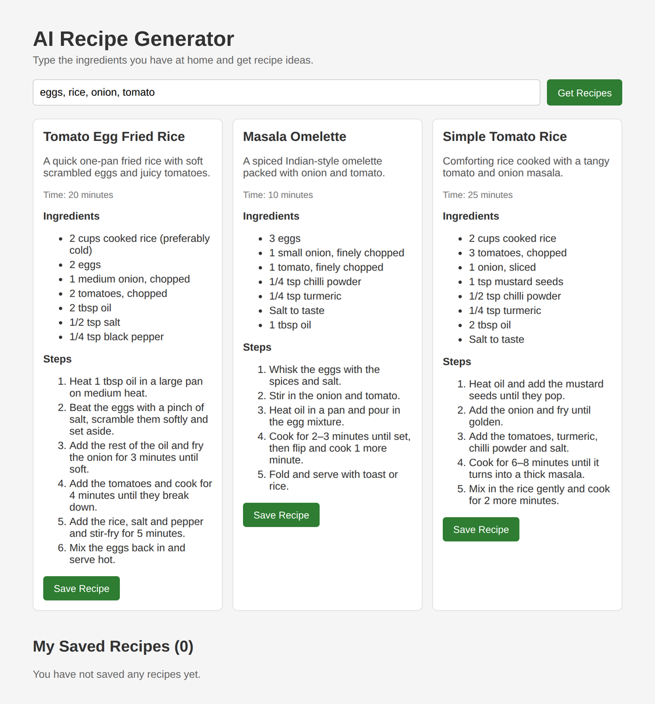
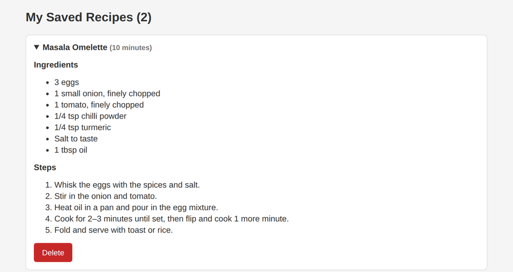

# AI Recipe Generator & Saver

A small full-stack app where you type the ingredients you have at home and it suggests 3 recipes you can cook with them. You can save the recipes you like and view or delete them later.

The recipes are generated with the Google Gemini API. Instead of asking Gemini for normal text, the backend asks it to reply in a fixed JSON format (title, description, cooking time, ingredients list and steps), so the frontend can show every recipe in the same card layout.



## Features

- Enter ingredients like `eggs, rice, onion, tomato` and get 3 recipe ideas
- Each recipe has a title, short description, cooking time, ingredients and step-by-step instructions
- Save recipes you like
- View saved recipes (click a title to open it) and delete them
- Saved recipes are kept in a JSON file on the server, so they stay after a refresh or restart

## Tech Stack

| Part | Used |
|------|------|
| Frontend | React (Vite), Axios, plain CSS |
| Backend | Node.js, Express.js |
| AI | Google Gemini API (`@google/genai`), free tier |
| Tools | dotenv, cors, nodemon |

## Project Structure

```
recipe-ai/
├── client/                    # React frontend
│   └── src/
│       ├── App.jsx            # main page, all API calls are here
│       ├── App.css
│       ├── main.jsx
│       └── components/
│           ├── RecipeCard.jsx     # shows one generated recipe
│           └── SavedRecipes.jsx   # list of saved recipes
└── server/                    # Express backend
    ├── server.js              # starts the server
    ├── routes/recipeRoutes.js
    ├── controllers/recipeController.js
    ├── ai/gemini.js           # prompt + call to Gemini
    └── .env.example
```

## How the AI part works

In `server/ai/gemini.js` the prompt includes the user's ingredients, and the request sets:

```js
config: {
  responseMimeType: 'application/json',
  responseJsonSchema: recipeFormat,
}
```

`recipeFormat` describes the exact JSON shape I want (a `recipes` array where each recipe has `title`, `description`, `cookingTime`, `ingredients` and `steps`). Gemini follows that shape, so the server can just do `JSON.parse(response.text)` and send the recipes to React.

## Getting Started

### 1. Requirements

- Node.js (version 20 or newer)
- A free Gemini API key from [Google AI Studio](https://aistudio.google.com/apikey)

### 2. Clone the repo

```bash
git clone https://github.com/ad1thhhhh/recipe-ai.git
cd recipe-ai
```

### 3. Start the backend

```bash
cd server
npm install
```

Make a copy of `.env.example`, name it `.env`, and paste your API key:

```
PORT=5000
GEMINI_API_KEY=your_key_here
GEMINI_MODEL=gemini-flash-latest
```

Then run:

```bash
npm run dev
```

The API runs on `http://localhost:5000`.

### 4. Start the frontend

Open a second terminal:

```bash
cd client
npm install
npm run dev
```

Open `http://localhost:5173` in the browser.

## API Endpoints

| Method | Endpoint | What it does |
|--------|----------|--------------|
| POST | `/api/recipes/generate` | Body: `{ "ingredients": "eggs, rice" }`. Returns 3 recipes |
| GET | `/api/recipes/saved` | Returns all saved recipes |
| POST | `/api/recipes/saved` | Saves a recipe |
| DELETE | `/api/recipes/saved/:id` | Deletes a saved recipe |

## Notes

- The free Gemini tier has a requests-per-minute limit. If you click too fast you will see "Free limit reached", so just wait a minute.
- The `.env` file is in `.gitignore`, so your API key is never uploaded to GitHub.

## Things I might add later

- User accounts so each person has their own saved recipes
- A database (MongoDB) instead of the JSON file
- Filters like vegetarian or max cooking time


